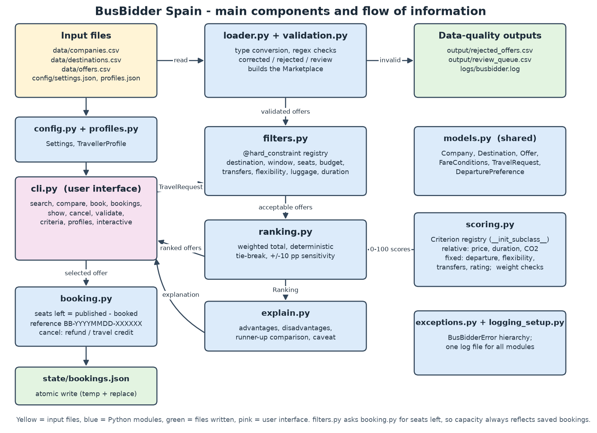

# 1 Introduction and problem interpretation

The central question of the project is: *how can a Python application filter and rank competing bus offers
according to the requirements and preferences of an individual traveller?* I built BusBidder Spain, a modular
command-line application. It loads simulated offers from five fictional bus companies, removes offers that break
the traveller's mandatory conditions, and ranks the rest with a transparent weighted scoring model. It explains
the recommendation, shows how different travellers receive different recommendations, and simulates a booking.

I read the question as having three parts, and they shaped the whole design.

1. **Filtering is a yes/no decision; ranking is a matter of degree.** An offer that goes to the wrong city or
   costs more than the traveller can pay is not a "bad" option, it is not an option at all. The program therefore
   separates hard constraints from soft preferences and shows both groups to the user.
2. **"Best" is relative to one traveller.** The same set of offers must be able to produce different answers.
   The weights, the preferred departure time and the constraints all belong to the traveller, not to the program.
3. **A ranking must be explainable.** The specification stresses that a transparent model is worth more than a
   complicated one. I therefore preferred simple, inspectable rules (linear scales, fixed categories, a weighted
   sum) and added tools that show *why* a result occurs and *how stable* it is.

## 1.1 Requirements and where they are met

| Requirement (specification) | Where it is met |
|---|---|
| Object-oriented model in several modules | `busbidder/` package, 13 modules (section 2) |
| Read and validate companies, destinations, offers | `loader.py`, `validation.py` (section 3) |
| Custom exceptions, regular expressions, log file | `exceptions.py`, `validation.py`, `logging_setup.py` |
| Separate hard constraints from preferences | `filters.py`, displayed by `cli.py` (section 4) |
| Weighted ranking with at least four criteria | `scoring.py`, `ranking.py` (section 5) |
| Explainable recommendation | `explain.py` (section 6.1) |
| At least three traveller profiles | `config/profiles.json`: five profiles (section 7.3) |
| Simulated booking with reference, capacity, fare conditions | `booking.py` (section 6.2) |
| Metaprogramming technique | decorator registry and `__init_subclass__` registry (section 2.3) |
| Intuitive interface | `cli.py`: ten sub-commands and an interactive mode |
| Reproducible ranking | deterministic scoring and tie-breaking, seeded data generator (section 9) |
| Tests: normal, invalid, missing, boundary | 188 pytest tests (section 7.1) |

## 1.2 Assumptions

* Madrid is the only origin. All offers are one-way, Madrid to one of the fifteen destinations.
* The dataset covers 10 to 16 July 2027. The example travel window "12-14 July" is read as 12-14 July 2027.
* A budget is a maximum price **per passenger**, because the specification's example traveller travels alone and
  prices are published per seat.
* "Morning" means 06:00 to 12:00, "afternoon" 12:00 to 18:00, "evening" 18:00 to 22:00 and "night" 22:00 to 06:00.
* The program uses a simulated clock (1 July 2027, 09:00) so that bookings are always made before departure and
  runs can be reproduced. The real clock can be used by removing one line from `config/settings.json`.

# 2 Software design and architecture

## 2.1 Components and flow of information

Figure 1 shows the main components. Data flows down the middle column: the loader turns files into validated
`Offer` objects, the filter removes unacceptable offers, the ranking engine scores the rest, and the explainer
describes the top offer. The command-line interface on the left builds the traveller's request, prints the
results and hands a selected offer to the booking service. Figure 2 shows the same process as a flowchart.

## 2.2 Responsibilities and collaboration

Each module has one responsibility, so a change in one concern touches one file.

| Module | Responsibility | Main classes / functions |
|---|---|---|
| `models.py` | Domain concepts and their own small behaviours | `Company`, `Destination`, `FareConditions`, `Offer`, `DeparturePreference`, `TravelRequest` |
| `validation.py` | Field parsing and regular expressions | `parse_money`, `parse_datetime`, `OFFER_ID_RE`, `BOOKING_REF_RE` |
| `loader.py` | Reading CSV files and applying the invalid-record policy | `Marketplace`, `LoadReport`, `load_offers` |
| `filters.py` | Hard constraints | `@hard_constraint`, `apply_hard_constraints`, `FilterResult` |
| `scoring.py` | Criteria, normalisation and weights | `Criterion`, `RelativeCriterion`, `AbsoluteCriterion`, `validate_weights` |
| `ranking.py` | Weighted totals, order, ties, sensitivity | `rank`, `Ranking`, `ScoredOffer` |
| `explain.py` | Text explanation generated from the scores | `explain_top` |
| `booking.py` | Seat inventory, references, persistence, cancellation | `BookingService`, `BookingStore`, `Booking` |
| `profiles.py`, `config.py` | Configuration files | `TravellerProfile`, `Settings` |
| `cli.py` | User interface and output formatting | `App`, one `cmd_*` function per command |
| `exceptions.py`, `logging_setup.py` | Error categories and logging | `BusBidderError` hierarchy |

The model classes are frozen dataclasses. Frozen objects cannot be changed by accident after validation, which
matters because the same `Offer` objects are shared by the filter, the ranking and the booking service.

**Composition** is used wherever one concept *has* another. An `Offer` has a `Company`, a `Destination` and a
`FareConditions` object instead of copying their fields. A company's name therefore exists in one place only, and
a `Booking` can store a copy of the `FareConditions` it was sold with.

**Inheritance** is used in one place where it gives real reuse: the scoring criteria. `Criterion` is an abstract
base class. `RelativeCriterion` implements the robust min-max normalisation once for price, duration and CO2.
`AbsoluteCriterion` implements fixed scales for departure fit, flexibility, transfers and rating. Each concrete
criterion only states how to read its raw value and how to describe it. I did not use inheritance for offers or
companies. The five companies differ in their data, not in their behaviour, so subclasses such as `NocheViaOffer`
would add classes without adding behaviour.

**Custom exceptions** form a small hierarchy under `BusBidderError`. Data errors (`DataFileError`,
`RecordValidationError` and its subclass `RecordNeedsReviewError`), request errors (`InvalidRequestError`,
`InvalidWeightsError`, `UnknownDestinationError`) and booking errors (`SeatUnavailableError`, ...) can be caught
separately where it matters. The interface catches the base class once, prints a clear message and exits with
code 2, so the user never sees a stack trace for an expected problem.

## 2.3 Metaprogramming: two registries

The program uses two registration mechanisms. Both remove long `if`/`elif` chains and make the set of rules
discoverable at run time.

* **Hard constraints - a decorator registry.** Each constraint is a short function decorated with
  `@hard_constraint("budget", "Maximum budget")`. The decorator stores the function and its user-facing label in
  a dictionary. The filter engine loops over the registry, so it does not need to know which constraints exist.
  Because the label travels with the function, every removed offer can be explained ("Maximum budget: EUR 52.65 >
  budget EUR 50.00"). A decorator suits this case because constraints are stateless functions.
* **Ranking criteria - a class registry using `__init_subclass__`.** Every concrete subclass of `Criterion`
  registers itself under its `key` when the class is defined. The weight parser uses the registry to reject
  unknown names and list the valid ones. The ranking engine uses it to build the criteria that have a weight, and
  the `criteria` command prints it. Adding a criterion (for example luggage) is one new class and nothing else.
  The registry also refuses a duplicate key, which a test checks. A class registry suits this case because
  criteria carry data (label, direction, description) and share normalisation code.

I considered a metaclass, but `__init_subclass__` gives the same effect with less hidden machinery.

## 2.4 Alternatives I rejected

* **One large script.** It would have been quicker, but the specification asks for collaborating modules, and
  separate modules made it possible to test filtering, scoring and booking in isolation.
* **Storing seat counts by rewriting `offers.csv`.** This would mix source data with runtime state and make every
  run depend on earlier runs. Section 6.2 describes the alternative I chose.
* **Silently rescaling weights that do not sum to 100 %.** A traveller who types `price=50` instead of `price=40`
  would never notice the mistake. The program rejects such weights with a message instead.

# 3 Dataset and validation

## 3.1 The dataset

The marketplace has five companies and fifteen destinations (`data/companies.csv`, `data/destinations.csv`).
Each destination has a road distance from Madrid and a coastal flag. The offers in `data/offers.csv` are
produced by `scripts/generate_offers.py` with a fixed random seed (4420), so the file can be regenerated exactly.

Every company serves every destination on each of the seven days, which gives all 75 company-destination
combinations required by the specification. Each departure is sold as a *basic* and a *flex* fare. The generator
gives each company the behaviour suggested by its profile:

| Company | Generated behaviour |
|---|---|
| SolRuta | Lowest price per km, daytime only, often one or two transfers on long routes, rigid basic fare |
| Camino Express | Fastest (about 85 km/h), always direct, about 60 % dearer than SolRuta, changeable fares |
| CostaLink | Cheap and frequent to coastal cities, slower and dearer with transfers inland |
| VerdeBus | Mid price, high customer rating, about 60 % lower CO2 per passenger, flexible fares |
| NocheVia | Departures 21:10 to 23:55, slower overnight journeys, flex fare refundable |

Each offer has 16 fields: offer id, company, destination, departure and arrival timestamps, stated duration,
price, transfers, luggage allowance, fare type, changeable, change fee, refundable, seats available, customer
rating (1-5, optional) and estimated CO2 per passenger (optional). About 3 % of ratings and 6 % of CO2 values are
deliberately left empty, so the missing-data rules are exercised on real data, and about 5 % of offers are sold
out.

The file contains 1,872 records: 1,856 generated offers and 16 hand-written faulty or messy records, one for
each validation rule.

## 3.2 Validation policy: corrected, rejected or placed aside

The specification asks whether invalid records are rejected, corrected or placed aside for review. I use all
three, chosen by one question: *is the intended value certain?*

| Outcome | When | Examples (category codes) |
|---|---|---|
| **Corrected** and kept | Harmless formatting; the intended value is certain | spaces around values, `val` -> `VAL`, decimal comma `19,50`, `yes`/`no` |
| **Rejected** | The value is impossible or unusable | `NEGATIVE_PRICE`, `ZERO_PRICE`, `UNKNOWN_DESTINATION`, `UNKNOWN_COMPANY`, `INVALID_DATE`, `ARRIVAL_BEFORE_DEPARTURE`, `RATING_OUT_OF_SCALE`, `NEGATIVE_SEATS`, `MISSING_FIELD`, `MALFORMED_ID`, `DUPLICATE_ID`, `INVALID_NUMBER` |
| **Placed aside for review** | Each value is plausible, but they contradict each other | `DURATION_MISMATCH`, `ID_MISMATCH`, `IMPLAUSIBLE_SPEED`, `FARE_INCONSISTENT` |
| **Kept, flagged** | A valid state that makes the offer unbookable | 0 seats (sold out) |

The review category is the most important design decision here. Take an offer whose stated duration is 240
minutes while its timestamps give 330 minutes. The program cannot know which value is wrong. Picking one would
quietly invent data, and discarding the record would lose a possibly valid departure. The record is therefore
excluded from ranking and written to `output/review_queue.csv` with its reason, for a human to resolve.

Zero seats is *not* treated as invalid. Every offer reaches zero seats when its last seat is booked, so zero
must be a legal value. Sold-out offers are loaded and counted, then removed by the seat-availability constraint.
The user sees them as "sold out", not as bad data.

Rejected records go to `output/rejected_offers.csv`. Every correction, rejection and review decision is also
logged with its line number and category, for example:

`WARNING | busbidder.loader | offers line 1858 (SOL-MAL-9001) rejected [NEGATIVE_PRICE]: price -12.50 is negative`

## 3.3 Where regular expressions are used, and where they are not

Regular expressions are used only where the input has a fixed *structure*:

* offer ids `AAA-BBB-0000`, where the named groups let the loader check that the prefix agrees with the company
  and destination columns;
* company and destination codes, three capital letters;
* booking references `BB-YYYYMMDD-XXXXXX`, using an alphabet without I, O, 0 and 1;
* timestamps `YYYY-MM-DDTHH:MM`, money amounts with an optional decimal comma, and integers;
* user input: weight lists (`price=40, duration=25`), departure times (`07:30`) and durations (`7h30`).

Checks that a pattern cannot express well are done in ordinary code. For example, `2027-02-30T08:00` matches the
timestamp pattern, so a second step with `datetime.strptime` rejects it as a date that does not exist.

## 3.4 Validation results on the real file

Running `python main.py validate` (transcript in `output/evidence/01_validate.txt`) gives:

| Result | Records |
|---|---|
| Read | 1,872 |
| Accepted | 1,857 (1 of them corrected, 101 sold out) |
| Rejected | 11 (one per rejection category listed above) |
| Placed aside for review | 4 (one per review category) |

All 1,856 generated offers were accepted, and each of the 16 deliberate anomalies was classified exactly as
intended. A test checks this outcome, so a change to the validation rules cannot alter it unnoticed.

# 4 Hard constraints and soft preferences

| Condition | Type | Justification |
|---|---|---|
| Destination, travel window | Hard (journey scope) | An offer to another city or date is not an alternative at all |
| Seat availability (party size) | Hard, always | An offer without enough seats cannot be booked |
| Maximum budget | Hard, optional | The traveller cannot pay more; the score still rewards cheaper offers within the budget |
| Maximum transfers | Hard, optional | Some travellers cannot manage a change (luggage, mobility, children) |
| Changeable / refundable ticket | Hard, optional | When stated as *required*, a rigid ticket is unacceptable |
| Minimum luggage, maximum journey time | Hard, optional | Physical or schedule limits |
| Preferred departure time | **Soft** | Leaving at 12:10 instead of "morning" is less convenient, not impossible |
| Price, duration, flexibility, transfers, rating, CO2 | **Soft** (weighted) | Matters of degree that can be traded against each other |

The rule I applied: a condition is **hard** if violating it makes the trip *unusable* for this traveller, and
**soft** if violating it only makes the trip *less pleasant*. Several conditions appear in both roles on
purpose. Price, for example, is a hard limit (the budget) and also a soft criterion (cheaper is better within
the budget). In the same way, the number of transfers can be capped and also scored.

The distinction is visible to the user. Every search prints two labelled blocks, "HARD CONSTRAINTS - an offer
that breaks any of these is removed before ranking" and "SOFT PREFERENCES - these only change the score". After
filtering, the program prints how many offers each constraint removed. With `--show-removed` it lists the removed
offers with *all* their violations, not only the first one, so the traveller can see which constraint to relax.
Offers outside the destination or travel window are counted separately, because they were never candidates.

# 5 Weighted ranking model

The total score of an acceptable offer *j* is the weighted sum of its criterion scores:

**Score(j) = sum over c of w_c x S_c(j)**, where each S_c(j) is between 0 and 100 and the weights w_c sum to 1.

The four required criteria are always used. Three optional ones (transfers, rating, CO2) can be added by giving
them a weight. The following subsections answer the five required design decisions.

## 5.1 Normalisation to a common 0-100 scale

Raw values in euros, minutes and categories cannot be added, so every criterion is mapped to 0-100, where 100 is
always "best for the traveller". I used two strategies, chosen per criterion.

**Relative scale (price, duration, CO2).** There is no natural "perfect" price, so an offer is compared with the
other acceptable offers using min-max scaling, made robust in two ways (section 5.4).

**Fixed scale (departure fit, flexibility, transfers, rating).** These criteria have a natural meaning of
"perfect", so an offer's score does not depend on which other offers happen to be in the list:

| Criterion | Rule |
|---|---|
| Departure fit | 100 inside the preferred window, falling linearly to 0 at 240 minutes outside it, measured on a 24-hour circle so "night" can wrap past midnight |
| Flexibility | free changes 60, changes with a fee 40, no changes 0; refundable adds 40 (maximum 100) |
| Transfers | direct 100, one transfer 50, two or more 0 |
| Rating | linear from 1 (0 points) to 5 (100 points) |

A specific preferred time such as 07:30 is treated as a window of plus or minus 30 minutes. The 240-minute
decay is a judgement call: four hours away from the preferred time is treated as fully inconvenient. It is a
setting in `config/settings.json`, not a hidden constant.

## 5.2 Lower-is-better and higher-is-better

All criteria are oriented so that 100 is best. For price, duration and CO2 (lower is better) the formula is
S = 100 x (1 - (x - lo) / span), so the cheapest acceptable offer receives 100. The fixed scales are written
directly in the "higher is better" direction. Every criterion can therefore be added with a positive weight, and
no criterion needs a negative sign that a user could forget.

## 5.3 Weight validation

Weights can be typed as percentages (`price=40,...`) or fractions (`price=0.4,...`). The program:

* accepts only names that exist in the criterion registry, and lists the valid names otherwise;
* rejects negative weights;
* requires a positive weight for each of the four core criteria, so every ranking uses at least four criteria;
* accepts totals of 100 (within 0.01) or 1.0 (within 0.0001), then normalises to fractions that sum to exactly 1;
* **rejects** any other total, for example "Weights total 110; they must total 100 (percent) or 1.0".

Profiles in `config/profiles.json` pass through the same validation when they are loaded, so an invalid profile
stops the program with a clear message.

## 5.4 Ties, missing values and extreme values

* **Ties.** Offers are sorted by total, rounded to six decimals to remove floating-point noise. Equal totals are
  ordered by lower price, then shorter duration, then earlier departure, then offer id. The result is fully
  deterministic. Offers whose displayed totals are equal are marked with "=" and the tie-break rule is printed.
* **Missing values.** An unpublished rating or CO2 value gets a neutral score of 50, a configurable setting, and
  is shown as `n/a*`. The explanation then says that a neutral score was used. Section 8.3 discusses the
  fairness of this choice.
* **Extreme values.** Before min-max scaling, the scale end-points are clipped to Tukey's fences, Q1 - 1.5 x IQR
  and Q3 + 1.5 x IQR, when at least four values exist. An extreme offer still receives 0 (or 100), but it can no
  longer stretch the scale and squeeze every other offer into a narrow band. Experiment E5 in section 7.5 shows
  why this matters.

## 5.5 Preventing one criterion from dominating unintentionally

Weights express *intended* importance. Normalisation can still give a criterion *unintended* importance, in two
ways that the model guards against:

1. **Tiny differences blown up.** With plain min-max scaling, two offers at EUR 30.00 and EUR 30.50 score 100 and
   0 on price, a 40-point swing in the total for 50 cents. I therefore use a **minimum meaningful range**:
   EUR 10 for price, 60 minutes for duration and 5 kg for CO2. The span of the scale is at least this range, so
   EUR 30.00 and EUR 30.50 score 100 and 95.
2. **One outlier compressing a scale.** This is handled by the outlier fences described in section 5.4.

In addition, the program reports the **sensitivity** of every result. It moves each weight by plus and minus 10
percentage points, rescales the other weights proportionally, and checks whether the winner changes. A
recommendation that survives every shift is labelled *robust*. Otherwise the program lists which shift would
change the winner. Normalised scores do not depend on the weights, so this check costs only a few
multiplications.

# 6 Recommendation and booking

## 6.1 Explainable recommendation

For every acceptable offer the ranked table shows the raw values (date, departure, arrival, duration, price,
transfers, fare, luggage, seats left), the score for each criterion and the total. The top offer then receives
an explanation that is generated only from the data:

* **advantages** are weighted criteria where the offer scores 75 or more;
* **disadvantages** are weighted criteria where it scores below 50;
* criteria in between are listed as **moderate**;
* the route type is always stated;
* a **comparison with the runner-up** says which criteria gained or lost how many points of the total;
* a **robustness** line comes from the sensitivity check, and a **missing-data** line appears when relevant;
* every explanation ends with a fixed caveat. The result is "the best match only under your hard constraints,
  your weights and the scoring assumptions - not an objectively best bus".

The business traveller's recommendation for Malaga illustrates this (from `output/evidence/04_compare_profiles_malaga.txt`):

> *Why it ranks highest: it offers a short journey (6h25, only 20 min longer than the fastest acceptable offer), a
> convenient departure at 07:10, inside your preferred 07:30 (07:00-08:00) window, a flexible fare (flex: free
> changes, refundable, 30 kg luggage) and a direct route. Remaining disadvantages: a higher price (EUR 52.65, EUR
> 23.05 more than the cheapest acceptable offer from SolRuta). [...] Sensitivity: the winner changes if a weight
> moves by 10 pp (price -10 pp -> Camino Express CAM-MAL-0020 [...]).*

## 6.2 Simulated booking

After a ranking the traveller can pick a rank number or offer id, enter a name and confirm. The design choices:

* **Seats are derived, not stored twice.** The published offer file is treated as read-only source data. Seats
  left are computed as published seats minus the seats held by confirmed bookings. There is no second counter
  that could drift out of step, a cancellation releases seats automatically, and the source data never changes.
  The filter asks the booking service for seats left, so a sold-out offer disappears from the next ranking.
* **Seats are re-checked at booking time.** The program does not trust the number shown in the ranking. Booking
  more seats than are left raises `SeatUnavailableError`.
* **Unique references** follow the pattern `BB-<travel date>-<6 characters>`, for example `BB-20270713-JALA46`.
  The six characters are random, so they differ between runs. References are validated by a regular expression
  and regenerated if they collide with an existing reference.
* **Fare conditions are copied into the booking**, so a later change to the offer data cannot change what the
  traveller bought.
* **Bookings are saved atomically.** The program writes a temporary file and then calls `os.replace`, so a crash
  cannot leave a half-written `state/bookings.json`.
* **No payment data is collected.** The payment status is "PAID (simulated)".

As an optional extension, `cancel` applies the stored fare conditions. A refundable fare gives a full simulated
refund. A changeable but non-refundable fare gives a travel credit of the price minus the change fee. A rigid
fare gives nothing back. Transcripts 06 to 09 in `output/evidence/` show the whole cycle. In transcript 06 a
2-seat booking takes the last 2 seats of `COS-MAL-0020`. Transcript 09 shows that booking a sold-out offer is
refused.

# 7 Testing and experimental evidence

## 7.1 Automated tests

The suite has 188 pytest tests (`python -m pytest`, about 6 seconds). Every test works on temporary copies of
the data, so the tests never touch `state/` or `output/`.

| Test file | Tests | What is covered |
|---|---|---|
| `test_loader.py` | 47 | every rejection and review category; corrections; missing optional and required fields; missing file and missing column; duplicate ids; rating scale edges 1.0 and 5.0; duration tolerance edge 10 vs 11 minutes; real file covers 75 combinations and classifies all 16 anomalies |
| `test_filters.py` | 30 | every constraint at its boundary (budget 49.99 / 50.00 / 50.01, window edges 23:59 / 00:00, transfers, seats = party size, luggage, duration); all violations reported; derived seats used; invalid requests refused |
| `test_scoring.py` | 52 | direction; identical values; single offer; minimum meaningful range; outlier clipping including the zero-IQR case; neutral missing values; scores within 0-100; departure decay and midnight wrap; flexibility categories; weight parsing and every weight error |
| `test_ranking.py` | 11 | total equals the weighted sum; weights change the winner; deterministic ties regardless of input order; identical results on repeated runs; sensitivity detection; explanation content |
| `test_booking.py` | 20 | reference format; seat reduction; persistence across restarts; booking the exact remaining seats; overbooking; sold out; invalid names and seat counts; departed offers; reference collision; refund, credit and no-refund cancellation; corrupt booking file |
| `test_profiles_cli.py` | 28 | profiles produce three different winners; invalid profiles and settings; simulated clock; end-to-end CLI runs of search, compare, book, cancel and the interactive selection; exit code 2 with clear messages |

Writing boundary tests exposed one real ambiguity, the end of the "morning" window. I defined windows as
half-open (06:00 <= t < 12:00). A 12:00 departure is then 0 minutes outside the window and still scores 100. A
test now fixes this behaviour, so it cannot change by accident.

## 7.2 The specification example

The request is Madrid to Malaga, 12-14 July, EUR 50, morning, at most 1 transfer, changeable ticket, and weights
40/25/15/20 (`output/evidence/03_example_search.txt`). Of 66 offers on the route, 29 were removed and 37 were
ranked. Some removed offers broke more than one constraint. In total, 19 were not changeable, 8 were over budget,
2 had two transfers and 2 were sold out. The top five:

| # | Offer | Company | Departs | Time | EUR | Tr | Fare | Price | Dur | Dep | Flex | Total |
|---|---|---|---|---|---|---|---|---|---|---|---|---|
| 1 | COS-MAL-0020 | CostaLink | Tue 06:25 | 7h00 | 33.25 | 0 | C | 82 | 74 | 100 | 60 | 78.4 |
| 2 | COS-MAL-0026 | CostaLink | Wed 06:55 | 7h40 | 33.45 | 0 | C | 81 | 56 | 100 | 60 | 73.3 |
| 3 | SOL-MAL-0016 | SolRuta | Tue 12:10 | 7h35 | 31.90 | 0 | C5 | 89 | 58 | 96 | 40 | 72.3 |
| 4 | SOL-MAL-0014 | SolRuta | Tue 06:50 | 8h10 | 30.60 | 1 | C5 | 95 | 42 | 100 | 40 | 71.5 |
| 5 | COS-MAL-0014 | CostaLink | Mon 06:35 | 7h15 | 36.35 | 0 | C | 67 | 67 | 100 | 60 | 70.5 |

*Fare: C = free changes, C5 = changes cost EUR 5. Criterion scores 0-100.*

**Is this reasonable?** I think so. The winner is EUR 3.65 above the cheapest acceptable offer, leaves at 06:25
inside the morning window, is direct, allows free changes and is among the faster journeys. The cheapest offer
(SolRuta, EUR 29.60) ranks lower because it is slower and its changes cost a fee. Rank 3 shows the soft
departure preference at work: a 12:10 departure, 10 minutes outside the window, loses only 4 points on
departure fit instead of being removed. The ranking passed the sensitivity check, so no single 10-point weight
change alters the winner.

## 7.3 Traveller-profile comparison 1: Madrid to Malaga

The same 66 offers were ranked for five profiles (`output/evidence/04_compare_profiles_malaga.txt`):

| Profile | Key constraints | Weights | Winner | EUR | Time | Fare | Robust |
|---|---|---|---|---|---|---|---|
| Example (spec) | EUR 50, <=1 transfer, changeable | P40 D25 Dep15 F20 | CostaLink 06:25 | 33.25 | 7h00 | C | yes |
| Budget | EUR 40, <=2 transfers | P65 D15 Dep5 F15 | SolRuta 16:40 | 25.10 | 8h00 | - | yes |
| Business | EUR 90, direct, changeable, <=8h | D40 Dep30 F20 P10 | Camino 07:10 | 52.65 | 6h25 | C+R | no |
| Flexible tourist | EUR 70, <=1 tr., changeable, >=20 kg | F45 P20 Dep15 D10 R10 | VerdeBus 16:10 | 44.10 | 7h15 | C+R | yes |
| Eco | EUR 60, <=1 transfer | CO2 45 P20 D10 F10 R10 Dep5 | VerdeBus 16:10 | 44.10 | 7h15 | C+R | no |

*P = price, D = duration, Dep = departure fit, F = flexibility, R = rating. C+R = free changes and refundable.*

The same data gives four different winners from four different companies, and each matches its traveller's
priorities. The budget traveller gets the cheapest ticket on the route, with a rigid fare that they accepted by
giving flexibility only 15 %. The business traveller gets the fastest direct morning bus with a refundable
ticket, at about twice the price. The flexible tourist and the eco traveller both get the same VerdeBus departure,
for different reasons. For the tourist it has the best flexibility, an afternoon departure and a high rating; for
the eco traveller it has the lowest CO2.

The business result is labelled "not robust", and this needs interpretation. The alternative winner is another
Camino Express departure at the same time of day (Tuesday 07:30, 6h20, EUR 59.65 instead of 52.65). The ranking
is sensitive *between practically equivalent options*, which is harmless for the traveller. A non-robust result
between materially different options, such as a cheap slow bus against an expensive fast one, would deserve
more caution.

## 7.4 Traveller-profile comparison 2: Madrid to Barcelona

The same comparison for Barcelona (`output/evidence/05_compare_profiles_barcelona.txt`) gives five different
offers from three companies:

| Profile | Winner | EUR | Time | Fare | Robust |
|---|---|---|---|---|---|
| Example (spec) | SolRuta, Wed 12:10 | 35.60 | 9h20 | C5 | no |
| Budget | SolRuta, Wed 12:10 | 30.20 | 9h20 | - | yes |
| Business | Camino Express, Mon 07:30 | 65.50 | 7h15 | C+R | no |
| Flexible tourist | VerdeBus, Tue 15:40 | 51.75 | 8h50 | C+R | no |
| Eco | VerdeBus, Mon 08:10 | 40.00 | 8h40 | C5 | no |

Barcelona is one of the longest routes in the dataset (620 km). Here the example traveller's winner departs at
12:10, ten minutes after the morning window. It loses only 4 points on departure fit, and it is the cheapest
acceptable offer (EUR 35.60). The best offer inside the window is CostaLink at 10:15 (EUR 39.55, free changes),
which ranks second with 72.1 against 75.9. The recommendation is flagged as not robust. This honestly signals a
close call between a cheaper offer and a better-timed one, which the traveller should look at.

## 7.5 Experiments on the scoring model

`python scripts/run_experiments.py` produces five experiments (`output/experiments/`).

**E1 - Which companies win?** I ranked all 15 destinations for each profile (12-14 July) and counted the winning
company:

| Profile | Camino Express | CostaLink | SolRuta | VerdeBus | NocheVia |
|---|---|---|---|---|---|
| Example (spec) | 2 | 6 | 5 | 2 | 0 |
| Budget | 1 | 3 | 11 | 0 | 0 |
| Business | 13 | 0 | 0 | 2 | 0 |
| Flexible tourist | 0 | 0 | 0 | 15 | 0 |
| Eco | 0 | 0 | 0 | 15 | 0 |

The pattern matches the company profiles, which suggests the model behaves sensibly. It also raises a fairness
question: **NocheVia never wins**. Section 8.3 discusses this.

**E2 - Price-weight sweep (example traveller, Malaga).** I varied the price weight from 10 % to 70 % and scaled
the other weights proportionally. The winner is the same CostaLink offer from 20 % to 60 %. At 10 % a dearer
VerdeBus offer (EUR 49.75) wins, and at 70 % a cheaper SolRuta offer with one transfer (EUR 30.60) wins. The
recommendation is stable over a wide band of reasonable weights and changes in the expected direction at the
extremes.

| Price weight | 10 % | 20-60 % | 70 % |
|---|---|---|---|
| Winner | VerdeBus EUR 49.75 | CostaLink EUR 33.25 | SolRuta EUR 30.60 (1 transfer) |

**E3 - Robust versus plain min-max normalisation (all destinations).** The two methods pick the same winner for
14 of 15 destinations. The exception is Toledo, the shortest route (75 km). There, all acceptable prices lie
between EUR 6.00 and EUR 8.55, and all journeys between 50 and 65 minutes. Plain min-max stretches differences of
a few cents and a few minutes over the full 0-100 range. A Camino Express basic fare (EUR 6.60, 50 minutes,
changes cost a fee) then wins. With the minimum meaningful ranges (EUR 10, 60 minutes), such small differences
count for little, and the clearly better fare conditions decide. A VerdeBus flex fare at EUR 7.50 with free
changes and refund wins. This is the dominance problem from section 5.5 appearing on real data. The robust
Toledo ranking also shows the tie-break at work. Two VerdeBus offers have exactly equal totals (89.83), the
same price (EUR 7.50) and the same duration (60 minutes), so the earlier departure, Monday 08:00, is placed
first. A Camino Express offer follows at 89.80.

**E4 - Effective influence.** For each criterion I measured the standard deviation of its weighted contribution
across the ranked offers, averaged over the destinations. Price has the largest effective influence (about 10
points) and flexibility the smallest (about 5.4). The order follows the weights, apart from departure fit
(6.9), whose influence is slightly larger than its 15 % weight suggests. Morning and non-morning departures
differ sharply on this criterion, so it separates offers strongly. A traveller who wants to know what really
drives the result needs this kind of measurement, not just the weights.

**E5 - Outlier stress test.** I removed the budget for the example traveller and added one artificial EUR 180
offer to the Malaga candidates:

| Setting | Winner | Price scores of the normal offers | Std. dev. |
|---|---|---|---|
| Robust, no outlier | COS-MAL-0020 | 0-100 | 25.7 |
| Robust, with outlier | COS-MAL-0020 | 4-100 | 24.6 |
| Plain min-max, no outlier | COS-MAL-0020 | 0-100 | 25.5 |
| Plain min-max, with outlier | **CAM-MAL-0022** | **80-100** | **5.1** |

With plain min-max, one offer that nobody would choose squeezed every other price score into 80-100. Price
effectively lost most of its 40 % weight, and the winner switched to a more expensive Camino Express offer. The
robust scale kept the ranking unchanged.

# 8 Evaluation, limitations and critical reflection

## 8.1 Does the program answer the central question?

Yes, within clear limits. The program filters by explicit mandatory conditions, ranks by a model the traveller
controls, and explains the result in terms the traveller can check: prices, minutes, fare conditions and score
contributions. The profile comparisons show that the recommendation follows the traveller, not a fixed opinion
built into the program. The experiments show that the ranking is stable over reasonable weights, changes in the
expected direction at the extremes, and tolerates extreme values. The strongest parts are, in my view, the
review-queue policy for inconsistent data, the derived seat inventory, the robust normalisation (backed by E3
and E5) and the sensitivity check.

## 8.2 Limitations of the scoring model

* **Relative scores depend on the other offers.** Price, duration and CO2 are compared within the current list.
  Adding or removing an irrelevant offer can therefore, in principle, change the order of two other offers.
  E5 shows this happening with plain min-max. The fences and minimum ranges reduce the effect, but cannot remove
  it entirely. Fixed reference scales (for example "EUR per 100 km") would avoid it, but they need market
  knowledge that a fictional dataset does not provide.
* **The weighted sum is compensatory.** A very good price can make up for a poor departure time. That is what the
  traveller asks for when setting the weights, but some travellers have veto criteria that are not hard limits.
  The program only partly addresses this, by letting such criteria be set as hard constraints.
* **Weights are hard to choose.** Few people know whether they mean 25 % or 35 % for duration. The sensitivity
  check and the price sweep (E2) help, but a better interface might ask the traveller to compare pairs of offers
  and derive the weights from the answers.
* **Many numbers are judgement calls.** The 240-minute departure decay, the flexibility points (60/40/40), the
  minimum ranges, the neutral score of 50 and the 75/50 explanation thresholds are all my own choices. They are
  visible in the settings and in the `criteria` command, but they are not derived from real traveller research.
* **The same bus can appear twice.** Basic and flex fares of one departure are separate offers, so the top three
  can contain the same physical bus twice (VerdeBus 16:10 in the eco ranking). Grouping fares under a departure
  would make the list clearer.
* **The sensitivity check is narrow.** It changes one weight at a time by a fixed 10 points and treats a switch
  between two nearly identical departures as "not robust" (section 7.3).

## 8.3 Possible unfair outcomes

**Unfairness to companies.** NocheVia never won across 75 profile-destination rankings (E1). The reasons are
partly in the data and partly in the model:

* In my generated data NocheVia is slightly dearer and slower than SolRuta, so on price and duration it is
  dominated.
* The model has no criterion for what an overnight bus is actually good for. It saves a night of accommodation
  and a day of travel time, and neither is captured.
* Any morning or afternoon preference penalises a 23:00 departure.

A real marketplace that ranked like this would make one company invisible, through modelling choices rather than
any judgement about its service. Possible fixes are an "arrival-time convenience" criterion, a saved-hotel-cost
adjustment or a night-travel profile. Equally, VerdeBus wins every eco and flexible ranking. That outcome is
intended for the eco profile, but it also follows from my own data generator.

**Unfairness through missing data.** An offer whose rating or CO2 is not published gets a neutral 50. Compared
with an excellent rating this is a penalty, and compared with a poor one it is a bonus, so a company could gain
by *not* publishing a poor rating. A stricter alternative is to use the lowest observed score for missing data,
which rewards transparency but may punish small companies without enough reviews. I chose the neutral value and
made it visible (`n/a*` and the missing-data sentence), but this is a policy choice with consequences.

**Unfairness through tie-breaking.** Equal totals are broken by lower price, which slightly favours low-cost
companies. In practice exact ties are rare with continuous prices, but the rule is printed whenever a tie occurs.

**Unfairness to travellers.** Profiles encode assumptions. A "budget traveller" profile with a 65 % price weight
may not suit every student, for example one with a disability who cannot manage transfers. Profiles are
therefore starting points: every constraint and weight can be overridden on the command line.

## 8.4 Other limitations

* All data is simulated. Prices, speeds and emissions come from simple per-kilometre rules, and the
  conclusions in E1 say as much about my generator as about the model.
* There is one origin and one-way trips only. Return trips, multi-city trips and connections between companies
  are not modelled.
* Bookings are stored in a single JSON file, which is safe for one user at a time but not for simultaneous users.
  A real system would need a database transaction for the "check seats, then book" step.
* The program uses a simulated clock, so it does not reject searches for dates in the past.

## 8.5 What I learned

The most useful lesson was that **normalisation is where most of the "opinion" in a scoring model hides**. The
weights look like the user's decision, but plain min-max scaling can quietly give a criterion far more or less
influence than its weight (E3, E5). I also learned that validation needs a third outcome besides "accept" and
"reject". For contradictory data, setting a record aside is more honest than guessing. Finally, tests at exact
boundaries (EUR 50.00, 23:59 versus 00:00, the 12:00 end of the morning window) forced me to make decisions I
would otherwise have left implicit.

# 9 Traceability and reproducibility

* **Environment:** Python 3.12.10 on Windows 11, with the standard library only. The tests use pytest 9.2.0. The
  application was also checked on Python 3.14.
* **Entry point:** `python main.py`. The exact commands are in `README.md`.
* **Data:** `scripts/generate_offers.py` with seed 4420 regenerates `data/offers.csv` exactly.
* **Determinism:** scoring and ranking contain no randomness, and ties are broken by fixed rules. A test runs the
  ranking three times and checks that the results are identical. Booking references are random by design, but
  bookings do not affect rankings except through seats left.
* **Configuration:** every tunable number is in `config/settings.json`, and the profiles are in
  `config/profiles.json`.
* **Evidence:** `scripts/make_evidence.py` regenerates all transcripts in `output/evidence/`, using its own booking
  file. `scripts/run_experiments.py` regenerates `output/experiments/`, and `scripts/draw_diagrams.py` and
  `scripts/build_report.py` regenerate the figures and this PDF.
* **Logs:** `logs/busbidder.log` records loading statistics, every rejected, corrected or reviewed record, each
  ranking (winner, weights and robustness) and every booking and cancellation.

# 10 Declaration of generative-AI use

**Tool used.** Claude (Anthropic), used through the Claude Code assistant in Visual Studio Code.

**What it was used for.** The assistant produced the first versions of the program design, the Python modules,
the data generator, the automated tests.
**How the generated material was checked.**

* All 188 automated tests were run and pass. They include boundary cases whose expected values were calculated
  by hand, for example the outlier-clipping and sensitivity cases.
* Each command was run manually and its output was read: search, compare, book, cancel, validate and every error
  path. The transcripts are kept in `output/evidence/`.
* The validation report was checked against the 16 deliberate anomalies, one by one.
* Rankings were checked for plausibility against the raw offer values (section 7.2).
* Weaknesses found during checking were fixed. For example, the first version of the explanation listed a
  positive point in negative wording, and a missing settings file produced a duplicated error message.
* Every number quoted in this report was taken from the generated output files.

# References

* Belton, V. and Stewart, T. J. (2002). *Multiple Criteria Decision Analysis: An Integrated Approach.* Kluwer
  Academic Publishers.
* Tukey, J. W. (1977). *Exploratory Data Analysis.* Addison-Wesley. (Outlier fences Q1 - 1.5 IQR, Q3 + 1.5 IQR.)
* Python Software Foundation (2025). *The Python Standard Library* - `re`, `csv`, `dataclasses`, `abc`,
  `statistics`, `argparse`, `logging`. https://docs.python.org/3/library/
* OsloMet (2026). *ACIT4420 BusBidder Spain - Final Project Specification.*
