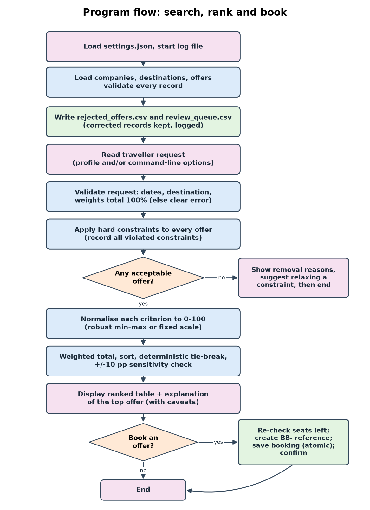

# 1 Introduction and problem interpretation

The central question is: *how can a Python application filter and rank competing bus offers according to the
requirements and preferences of an individual traveller?* I built BusBidder Spain, a modular command-line
application that loads offers from five fictional companies, removes offers that break the traveller's mandatory
conditions, ranks the rest with a transparent weighted model, explains the result and simulates a booking.

I read the question as three ideas that shaped the design:

1. **Filtering is yes/no; ranking is a matter of degree.** An offer to the wrong city or above the budget is not a
   bad option, it is no option. Hard constraints and soft preferences are therefore separated and both shown.
2. **"Best" is relative to one traveller.** Weights, preferred departure and constraints belong to the traveller,
   so the same offers can give different answers.
3. **A ranking must be explainable.** I preferred simple, inspectable rules and added tools that show *why* a
   result occurs and *how stable* it is.

**Assumptions.** Madrid is the only origin and trips are one-way. The data covers 10-16 July 2027, so "12-14 July"
means 2027. The budget is per passenger. "Morning" is 06:00-12:00, "afternoon" 12:00-18:00, "evening"
18:00-22:00 and "night" 22:00-06:00. A simulated clock (1 July 2027, 09:00) makes runs reproducible.

# 2 Software design and architecture

Figure 1 shows the components. Data flows down the middle: the loader turns files into validated `Offer` objects,
the filter removes unacceptable offers, the ranking engine scores the rest and the explainer describes the top
offer. The interface builds the request, prints results and passes a chosen offer to the booking service.
Figure 2 shows the same process as a flowchart.

The `busbidder/` package has 13 modules with one responsibility each (for example `loader.py`, `filters.py`,
`scoring.py`, `ranking.py`, `booking.py`, `cli.py`).

* **Frozen dataclasses** model companies, destinations, fares and offers. They cannot be changed by accident after
  validation, which matters because the filter, ranking and booking share the same objects.
* **Composition:** an `Offer` *has* a `Company`, a `Destination` and `FareConditions`, so each fact exists once.
* **Inheritance** is used only where it gives real reuse. `RelativeCriterion` implements robust min-max scaling
  once for price, duration and CO2; `AbsoluteCriterion` implements fixed scales. I did not subclass offers per
  company: the companies differ in data, not behaviour.
* **Custom exceptions** form a hierarchy under `BusBidderError` (data, request and booking errors). The interface
  catches the base class, prints a clear message and exits with code 2, so expected problems never show a stack
  trace.

**Metaprogramming.** Hard constraints are registered with a decorator, `@hard_constraint("budget", "Maximum
budget")`, so the filter loops over a registry and every removal carries a readable label. Ranking criteria
register themselves through `__init_subclass__`, so the weight parser, ranking engine and `criteria` command
discover them, and a new criterion is one new class. I chose `__init_subclass__` over a metaclass because it
achieves the same with less hidden machinery.

**Rejected alternatives:** one large script (hard to test in isolation), storing seat counts by rewriting
`offers.csv` (mixes source data with state), and silently rescaling weights that do not sum to 100 % (hides typing
mistakes).

# 3 Dataset and validation

The marketplace has five companies and fifteen destinations. `scripts/generate_offers.py` (seed 4420) produces
offers for all 75 company-destination combinations on seven days, each departure sold as a *basic* and a *flex*
fare. Companies follow their profiles: SolRuta cheapest, Camino Express fastest, CostaLink cheap to the coast,
VerdeBus low-CO2 and highly rated, NocheVia overnight. Each offer has 16 fields; some ratings and CO2 values are
deliberately empty and about 5 % of offers are sold out. The file holds 1,872 records: 1,856 generated and 16 hand-written faulty records, one
per validation rule.

The policy depends on one question: *is the intended value certain?*

| Outcome | When | Examples |
|---|---|---|
| **Corrected** | Harmless formatting | spaces, `val` -> `VAL`, decimal comma `19,50` |
| **Rejected** | Impossible or unusable value | `NEGATIVE_PRICE`, `INVALID_DATE`, `UNKNOWN_COMPANY`, `DUPLICATE_ID` (12 categories) |
| **Review** | Plausible values that contradict each other | `DURATION_MISMATCH`, `ID_MISMATCH`, `IMPLAUSIBLE_SPEED`, `FARE_INCONSISTENT` |
| **Kept, flagged** | Valid but unbookable | 0 seats (sold out) |

The review category is the key decision. If the stated duration is 240 minutes but the timestamps give 330, the
program cannot know which is wrong: guessing invents data and discarding loses a possibly valid departure. Such
records go to `output/review_queue.csv` for a human. Zero seats is valid, since every offer reaches zero when its
last seat is sold. All decisions are logged with line number and category.

Regular expressions are used only for structured input: offer ids (`AAA-BBB-0000`, whose groups are checked against
the company and destination columns), codes, booking references, timestamps, money amounts and user input such as
weight lists. Checks a pattern cannot express are done in code; `2027-02-30T08:00` matches the pattern but is
rejected by `datetime.strptime`.

`python main.py validate` (`output/evidence/01_validate.txt`) read 1,872 records: 1,857 accepted (1 corrected, 101
sold out), 11 rejected and 4 placed for review. Every deliberate anomaly was classified as intended, and a test
locks this outcome.

# 4 Hard constraints and soft preferences

My rule: a condition is **hard** if violating it makes the trip *unusable*, and **soft** if it only makes the trip
*less pleasant*.

| Condition | Type | Justification |
|---|---|---|
| Destination, travel window, seats | Hard, always | Otherwise not an alternative or not bookable |
| Budget, transfers, changeable/refundable, luggage, journey time | Hard, optional | Real limits of money, mobility or schedule |
| Preferred departure | **Soft** | Leaving at 12:10 instead of "morning" is less convenient, not impossible |
| Price, duration, flexibility, transfers, rating, CO2 | **Soft** (weighted) | Matters of degree that can be traded |

Price appears in both roles on purpose: the budget is a hard limit, and cheaper is still better within it. Every
search prints two labelled blocks, "HARD CONSTRAINTS" and "SOFT PREFERENCES", followed by how many offers each
constraint removed; `--show-removed` lists all violations per offer so the traveller can see what to relax.

# 5 Weighted ranking model

**Score(j) = sum over c of w_c x S_c(j)**, where each S_c(j) is 0-100 (100 = best for the traveller) and the
weights sum to 1. The four required criteria are always used; transfers, rating and CO2 can be added.

**Normalisation.** Price, duration and CO2 have no natural "perfect" value, so they use a relative scale against the
other acceptable offers: S = 100 x (1 - (x - lo) / span), which also turns lower-is-better into higher-is-better.
The other criteria use fixed scales, so a score does not depend on which other offers are present:

| Criterion | Rule |
|---|---|
| Departure fit | 100 inside the window, falling linearly to 0 at 240 minutes outside (wraps past midnight) |
| Flexibility | free changes 60, changes with fee 40, none 0; refundable adds 40 |
| Transfers | direct 100, one 50, two or more 0 |
| Rating | linear from 1 (0) to 5 (100) |

All criteria point the same way, so no criterion needs a negative weight a user could forget.

**Weight validation.** Weights may be percentages or fractions. Unknown names, negative weights, a missing core
criterion or a total other than 100 (or 1.0) are **rejected** with a message, for example "Weights total 110".
Profiles pass the same validation.

**Ties, missing and extreme values.** Equal totals are ordered by lower price, shorter duration, earlier departure,
then offer id, so the order is deterministic. An unpublished rating or CO2 value gets a neutral 50, shown as `n/a*`.
For relative scales, the end-points are clipped to Tukey's fences (Q1 - 1.5 IQR, Q3 + 1.5 IQR), so one extreme
offer cannot stretch the scale.

**Preventing unintended dominance.** With plain min-max, EUR 30.00 and EUR 30.50 would score 100 and 0, a 40-point
swing for 50 cents. A **minimum meaningful range** (EUR 10, 60 minutes, 5 kg CO2) makes them score 100 and 95. The
program also runs a **sensitivity check**: each weight is moved by plus and minus 10 percentage points, and the
result is labelled *robust* only if the winner never changes.

# 6 Recommendation and booking

The ranked table shows raw values, each criterion score and the total. The explanation of the top offer is
generated from the data: weighted criteria scoring 75 or more are advantages, below 50 disadvantages, the rest
moderate. It adds a comparison with the runner-up, the robustness result, a missing-data note when relevant, and
the caveat that it is "not an objectively best bus". For the business traveller to Malaga
(`output/evidence/04_compare_profiles_malaga.txt`):

> *Why it ranks highest: it offers a short journey (6h25, only 20 min longer than the fastest acceptable offer), a
> convenient departure at 07:10 [...]. Remaining disadvantages: a higher price (EUR 52.65 [...]).*

Booking design choices:

* **Seats are derived, not stored twice:** published seats minus seats held by confirmed bookings. The source file
  stays read-only, cancellation frees seats automatically, and sold-out offers vanish from the next ranking.
* Seats are **re-checked at booking time**; overbooking raises `SeatUnavailableError`.
* **Unique references** such as `BB-20270713-JALA46` are validated by a regular expression.
* Fare conditions are **copied into the booking**, and bookings are **saved atomically** (`os.replace`).
* No payment data is collected; the status is "PAID (simulated)".

Cancellation applies the fare: refundable gives a full refund, changeable gives travel credit minus the change fee,
rigid gives nothing. Transcripts 06-09 in `output/evidence/` show the cycle, including a refused booking on a
sold-out offer.

# 7 Testing and experimental evidence

## 7.1 Automated tests

The suite has 190 pytest tests (`python -m pytest`, about 6 seconds), all on temporary copies of the data. They
cover normal cases, every rejection and review category, missing fields and files, every weight error, and exact
boundaries: budget 49.99 / 50.00 / 50.01, window edges 23:59 / 00:00, seats equal to party size, rating 1.0 and
5.0, booking the last seat, deterministic ties and end-to-end CLI runs. Boundary testing exposed one real ambiguity,
the end of the morning window; I defined windows as half-open, and a test now fixes that behaviour.

## 7.2 The specification example

Madrid to Malaga, 12-14 July, EUR 50, morning, at most 1 transfer, changeable, weights 40/25/15/20
(`output/evidence/03_example_search.txt`). Of 66 offers, 29 were removed (19 not changeable, 8 over budget, 2 with
two transfers, 2 sold out; some broke several) and 37 ranked:

| # | Offer | Departs | Time | EUR | Fare | Price | Dur | Dep | Flex | Total |
|---|---|---|---|---|---|---|---|---|---|---|
| 1 | COS-MAL-0020 | Tue 06:25 | 7h00 | 33.25 | C | 82 | 74 | 100 | 60 | 78.4 |
| 2 | COS-MAL-0026 | Wed 06:55 | 7h40 | 33.45 | C | 81 | 56 | 100 | 60 | 73.3 |
| 3 | SOL-MAL-0016 | Tue 12:10 | 7h35 | 31.90 | C5 | 89 | 58 | 96 | 40 | 72.3 |

This is reasonable: the winner is only EUR 3.65 above the cheapest acceptable offer, direct, inside the morning
window and with free changes. Rank 3 shows the soft preference at work: 10 minutes outside the window costs only 4
departure points instead of removal. The result is robust.

## 7.3 Profile comparisons

The same offers were ranked for five profiles (`output/evidence/04_compare_profiles_malaga.txt` and
`05_compare_profiles_barcelona.txt`):

| Profile | Main weights | Malaga winner | Barcelona winner |
|---|---|---|---|
| Example | P40 D25 F20 Dep15 | CostaLink EUR 33.25, 7h00 | SolRuta EUR 35.60, 9h20 |
| Budget | P65 D15 F15 | SolRuta EUR 25.10, rigid fare | SolRuta EUR 30.20 |
| Business | D40 Dep30 F20 | Camino EUR 52.65, 6h25, refundable | Camino EUR 65.50, 7h15 |
| Flexible tourist | F45 P20 | VerdeBus EUR 44.10, refundable | VerdeBus EUR 51.75 |
| Eco | CO2 45 P20 | VerdeBus EUR 44.10 | VerdeBus EUR 40.00 |

*P = price, D = duration, F = flexibility, Dep = departure fit.*

Malaga gives four winners from four companies, each matching its traveller. The business result is "not robust",
but the alternative is another Camino Express bus at 07:30 (EUR 59.65), a practically equivalent option. In
Barcelona the example winner departs at 12:10, just outside the window, but is cheapest; the best in-window offer
(CostaLink 10:15, EUR 39.55) is second, 72.1 against 75.9, a close call the "not robust" flag reveals.

## 7.4 Experiments

`scripts/run_experiments.py` writes five experiments to `output/experiments/`.

* **E1 - Winners across all 15 destinations.** Business is won by Camino Express 13 times, budget by SolRuta 11
  times, flexible and eco by VerdeBus 15 times. The pattern fits the company profiles, but **NocheVia never wins**
  (section 8.2).
* **E2 - Price-weight sweep.** The same CostaLink offer wins from 20 % to 60 % price weight; at 10 % a dearer
  VerdeBus (EUR 49.75) wins and at 70 % a cheaper SolRuta with a transfer (EUR 30.60). The result is stable over
  reasonable weights and moves in the expected direction at the extremes.
* **E3 - Robust versus plain min-max.** Same winner for 14 of 15 destinations. On Toledo (75 km, prices EUR
  6.00-8.55), plain min-max blows up cent differences and a Camino basic fare with a change fee (EUR 6.60) wins; with minimum ranges a VerdeBus
  fare with free changes and refund wins.
* **E4 - Effective influence.** Measured as the spread of each weighted contribution, price has the largest
  influence (about 10 points) and flexibility the smallest (about 5.4). Departure fit (6.9) matters slightly more
  than its 15 % weight suggests, because morning and non-morning offers differ sharply.
* **E5 - Outlier stress test.** Adding one EUR 180 offer without a budget left the robust ranking unchanged. With
  plain min-max it squeezed all normal price scores into 80-100 (std. dev. 5.1 instead of 25.5), and the winner
  switched to a dearer Camino offer (CAM-MAL-0022).

# 8 Evaluation, limitations and critical reflection

## 8.1 Does the program answer the question?

Yes, within clear limits. It filters by explicit conditions, ranks by a model the traveller controls and explains
the result in checkable terms; recommendations follow the traveller and are stable over reasonable weights. The
strongest parts are the review queue, the derived seat inventory, the robust normalisation and the sensitivity
check.

**Limitations of the model:**

* **Relative scores depend on the other offers**, so an irrelevant offer can in principle reorder two others. The
  fences and minimum ranges reduce this but cannot remove it; fixed reference scales would need real market data.
* **The weighted sum is compensatory**: a great price can make up for a bad departure. Veto criteria must be set as
  hard constraints.
* **Weights are hard to choose.** The sensitivity check and E2 help; asking travellers to compare pairs of offers
  could derive weights better.
* **Many numbers are judgement calls**: the 240-minute decay, flexibility points, minimum ranges, neutral 50 and the
  75/50 thresholds. They are visible in the settings but not based on traveller research.
* Basic and flex fares of one bus are separate offers, so the same bus can appear twice in the top three.

## 8.2 Possible unfair outcomes

* **Companies:** NocheVia never won in 75 rankings. Partly my data makes it dearer and slower than SolRuta, but the
  model also ignores what overnight travel offers (a saved hotel night and travel day), and any daytime preference
  penalises 23:00 departures. A real marketplace ranking like this would make one company invisible through
  modelling choices. An arrival-time criterion or a night-travel profile could fix it.
* **Missing data:** a neutral 50 penalises an unrated good company but rewards hiding a poor rating. Using the
  lowest observed score rewards transparency but may punish small companies. I made the choice visible (`n/a*`),
  but it is a policy with consequences.
* **Tie-breaking** by lower price slightly favours low-cost companies, although exact ties are rare.
* **Travellers:** profiles encode assumptions; a "budget" profile may not suit a student who cannot manage
  transfers. Every constraint and weight can therefore be overridden.

## 8.3 Other limitations and what I learned

All data is simulated, so E1 says as much about my generator as about the model. There is one origin and no return
trips, and the single JSON booking file is safe for one user only; a real system needs database transactions.

The main lesson: **normalisation is where most of the "opinion" in a scoring model hides.** Weights look like the
user's decision, but plain min-max can silently change a criterion's influence (E3, E5). I also learned that
validation needs a third outcome besides accept and reject, and that boundary tests force decisions that would
otherwise stay implicit.

# 9 Traceability and reproducibility

Python 3.12.10 (Windows 11), standard library only; tests use pytest 9.2.0. The entry point is `python main.py`,
with exact commands in `README.md`. Seed 4420 regenerates the data, ranking has no randomness, and every tunable
number is in `config/settings.json`. `scripts/make_evidence.py`, `run_experiments.py`, `draw_diagrams.py` and
`build_report.py` regenerate the evidence, experiments, figures and this PDF. `logs/busbidder.log` records every
validation decision, ranking and booking.

# 10 Declaration of generative-AI use

**Tool used.** Claude (Anthropic), used through the Claude Code assistant in Visual Studio Code.

**What it was used for.** The assistant produced the first versions of the program design, the Python modules,
the data generator, the automated tests.
**How the generated material was checked.**

* All 190 automated tests were run and pass. They include boundary cases whose expected values were calculated
  by hand, for example the outlier-clipping and sensitivity cases.
* Each command was run manually and its output was read: search, compare, book, cancel, validate and every error
  path. The transcripts are kept in `output/evidence/`.
* The validation report was checked against the 16 deliberate anomalies, one by one.
* Rankings were checked for plausibility against the raw offer values (section 7.2).
* Weaknesses found during checking were fixed. For example, the first version of the explanation listed a
  positive point in negative wording, and a missing settings file produced a duplicated error message.
* Every number quoted in this report was taken from the generated output files.

# References

* Belton, V. and Stewart, T. J. (2002). *Multiple Criteria Decision Analysis: An Integrated Approach.* Kluwer
  Academic Publishers.
* Tukey, J. W. (1977). *Exploratory Data Analysis.* Addison-Wesley. (Outlier fences Q1 - 1.5 IQR, Q3 + 1.5 IQR.)
* Python Software Foundation (2025). *The Python Standard Library* - `re`, `csv`, `dataclasses`, `abc`,
  `statistics`, `argparse`, `logging`. https://docs.python.org/3/library/
* OsloMet (2026). *ACIT4420 BusBidder Spain - Final Project Specification.*
